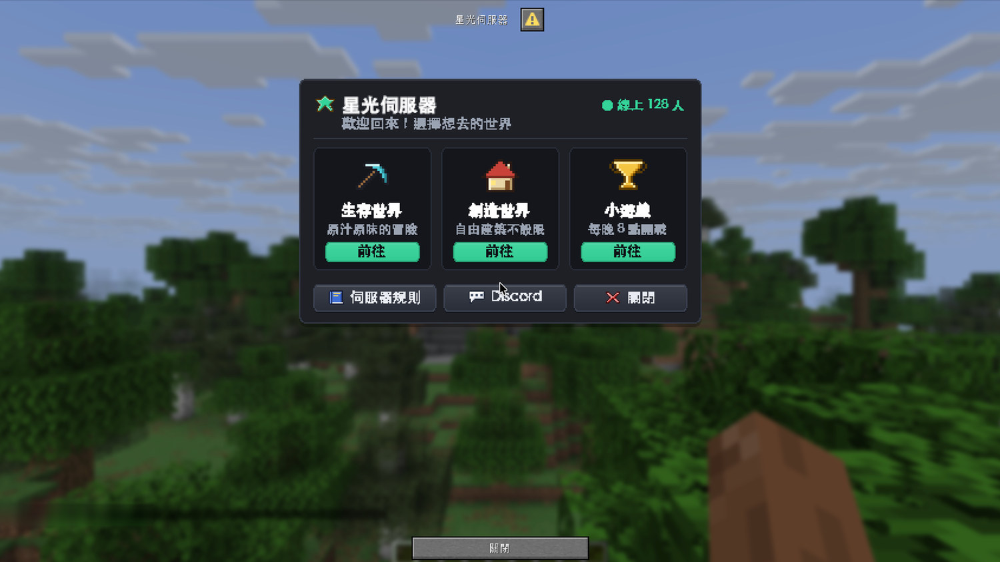
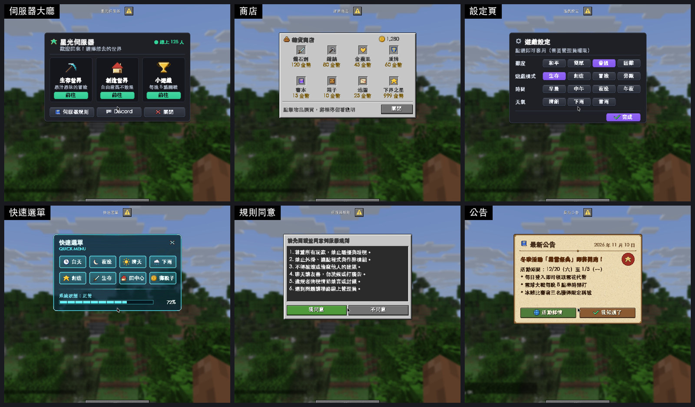
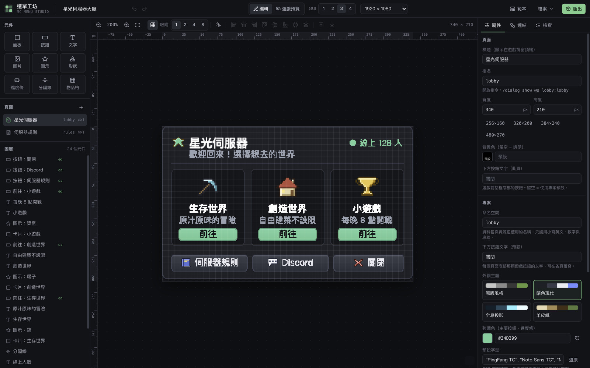
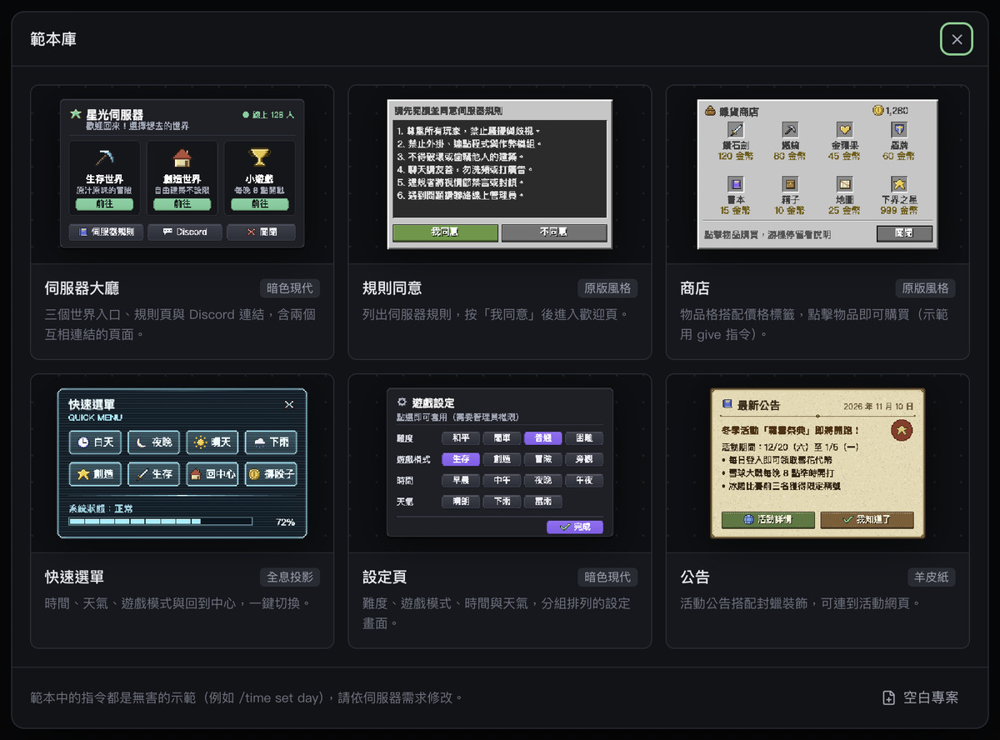
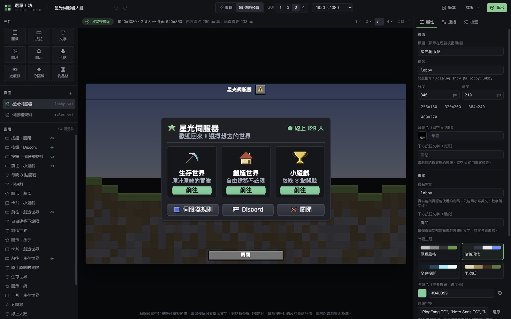
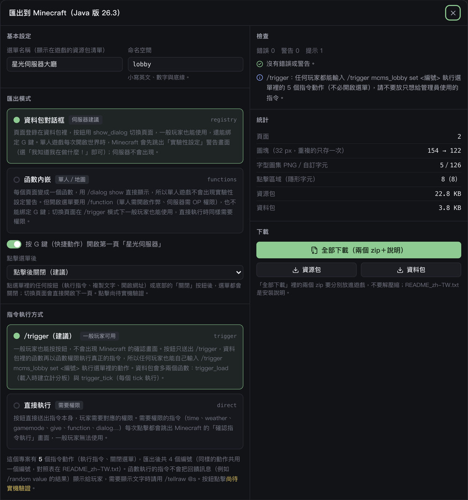
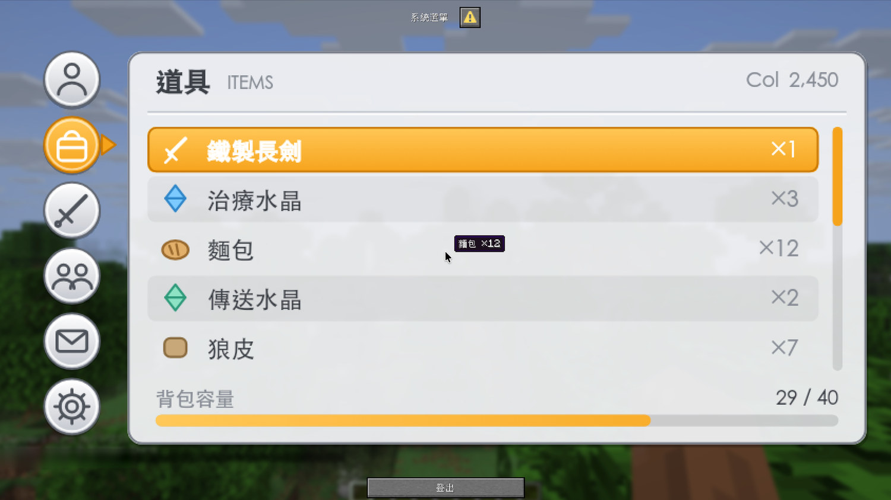
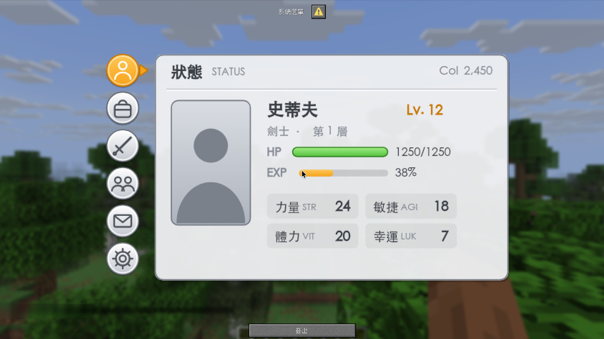

# 選單工坊 MC Menu Studio

在瀏覽器裡用拖拉的方式設計 Minecraft Java 版的選單，匯出後放進遊戲就能用。



選單會顯示在 Minecraft 內建的「對話框」（Dialog）裡。對話框是 Java 版本來就有的畫面，可以用指令打開，用來顯示文字和按鈕。選單工坊把你設計的選單變成圖片放進對話框，再在按鈕的位置疊上看不見的點擊區域。

不需要模組，伺服器也不用裝外掛。選單只用原版的「資源包」（改變遊戲外觀的檔案，例如材質和字型，每位玩家都要載入）和「資料包」（放在世界資料夾裡的指令和遊戲內容）。編輯器介面全是繁體中文，選單裡也可以放中文。適合想替伺服器做大廳、商店、規則頁的管理員，做地圖的人，或是好奇原版能做到什麼程度的玩家。

上圖是 Minecraft Java 版 26.3 單人遊戲的實際截圖（內建範本「星光伺服器大廳」）。最上方的小標題和警告圖示、最下方的「關閉」按鈕屬於 Minecraft 的對話框，無法移除。

## 能做出什麼

編輯器內建 6 個範本，下面是它們在遊戲裡的實際截圖：



選單裡可以放面板、按鈕、文字、圖片、圖示、形狀、進度條、分隔線和物品格。按鈕可以切換到另一頁、執行指令、開啟網址、複製文字或關閉選單，滑鼠停在上面時還能顯示提示文字。哪些已經在遊戲裡實測過，請看[目前實測到哪裡](#目前實測到哪裡)。

## 開始使用

流程分成四步：安裝並啟動編輯器、設計選單、匯出、放進 Minecraft。

### 1. 安裝並啟動編輯器

選單工坊目前沒有線上版，要在你自己的電腦上執行；編輯器不會把你的專案傳到網路上。我們只在 macOS（Node.js 24）上開發和測試過，Windows 和 Linux 還沒有測試。

1. 到 [nodejs.org](https://nodejs.org/) 下載並安裝 Node.js，選 LTS 版本即可（需要 20.9 以上）。
2. 下載這個專案：在 GitHub 頁面按綠色的「Code」按鈕 →「Download ZIP」，解壓縮到一個你找得到的資料夾。會用 git 的話，也可以用 `git clone`。
3. 打開終端機（輸入指令的程式），並切換到這個資料夾：
   - macOS：打開「終端機」App，輸入 `cd `（cd 後面有一個空格），把專案資料夾拖進終端機視窗，再按 return 鍵。
   - Windows：在檔案總管打開專案資料夾，點一下上方的網址列，輸入 `cmd` 後按 Enter，就會在這個資料夾開啟「命令提示字元」。
4. 第一次使用時，輸入下面這行並按 Enter。它會從網路下載編輯器需要的套件，大約要等幾分鐘：

   ```
   npm install
   ```

5. 啟動編輯器：

   ```
   npm run dev
   ```

   終端機出現 `http://localhost:3737` 之後，用瀏覽器打開 <http://localhost:3737>。
6. 用完後回到終端機按 `Ctrl + C` 關閉。之後每次使用，只要做第 3 步和第 5 步。

請用 `npm run dev` 啟動，不要用 `npx next dev`：`npm run dev` 會關掉 Next.js（編輯器使用的網頁框架）的匿名使用統計，`npx next dev` 不會。

### 2. 設計選單



編輯器分成三塊。左邊是「元件」、「頁面」和「圖層」：元件點一下就會加入畫布，也可以直接拖過去；一個選單可以有好幾頁。中間是畫布，可以放大 1 到 8 倍，有尺規、格線、吸附和對齊工具，復原／重做最多 200 步。右邊的「屬性」用來修改選取的元件；沒有選取任何東西時，這裡會顯示頁面和專案的設定，例如頁面大小、標題、外觀主題和字型。「連結」列出各頁之間怎麼連結，「檢查」列出匯出前要處理的問題，點一下就會跳到對應的位置。

可用的元件有 9 種：面板、按鈕、文字、圖片（上傳 PNG、JPG 或 WebP）、圖示（28 個內建的 16×16 像素圖示，可以換顏色）、形狀、進度條、分隔線和物品格。外觀主題有 4 種：原版風格、暗色現代、全息投影、羊皮紙。

按鈕、文字、圖片、形狀和圖示都可以在「屬性」的「互動」裡設定「點擊後」要做什麼：開啟頁面、執行指令、開啟網址、複製文字到剪貼簿或關閉選單。「滑鼠提示」是玩家把游標停在上面時顯示的文字。

不想從空白開始，可以按頂端的「範本」挑一個來改：



範本裡的指令都是無害的示範（例如 `/time set day`、`/weather clear`、`/give`），請改成你需要的指令。專案會自動存在瀏覽器裡；「檔案」選單有「新專案」、「從範本開始…」、「匯入專案 JSON…」和「匯出專案 JSON」（備份用）。

想知道放進遊戲後的樣子，按頂端的「遊戲預覽」：



選單會畫在模擬的 Minecraft 對話框裡。頂端的「GUI 1–4」是 Minecraft 的 GUI 縮放，也就是遊戲「選項 → 顯示設定」裡的「介面大小」（GUI Scale）：數字越大，遊戲的按鈕和文字越大，能放選單的空間就越小。旁邊的解析度請選玩家的遊戲視窗大小（全螢幕時通常就是螢幕解析度）。

預覽上方寫「可完整顯示」，表示在這個解析度和 GUI 縮放下，玩家不用捲動就能看到整頁；寫「高度不足，玩家需要捲動」或「寬度超出視窗」時，請把頁面改小，或參考[選單最大可以多大](#選單最大可以多大)。右邊的 1–4 標出每個 GUI 縮放放不放得下。這些都是估計值：高度估得比遊戲保守，寬度則比較寬鬆，那一節有詳細說明。在預覽裡點按鈕可以模擬切換頁面等動作，滑鼠停著可以看提示文字。

### 3. 匯出

按右上角的「匯出」：



「選單名稱」會顯示在遊戲的資源包清單。「命名空間」是資料包和資源包用來區分檔案的名稱，只能用小寫英文、數字和底線，會出現在檔名和指令裡（例如 `/function lobby:show_lobby`）。同一個世界放好幾個選單時，每個專案要用不同的命名空間，以免檔案互相覆蓋。

接著有兩個選擇要看清楚。第一個是「匯出模式」：

- 「資料包對話框」：頁面登錄在資料包裡，一般玩家也能使用，還能綁定 G 鍵開啟選單，適合伺服器。在單人遊戲裡，每次開啟世界都會先跳出「使用實驗性設定的世界不受支援」畫面，選「我知道我在做什麼！」就能進入；伺服器不會出現這個畫面。這是匯出視窗第一次打開時預先選好的模式，但**還沒有在實際遊戲裡試過**，只用 Minecraft 自己的程式碼檢查過檔案格式。
- 「函數內嵌」：每個頁面變成一個函數（function，寫在資料包裡的一串指令），用 `/function <命名空間>:show_<頁面>` 開啟。不會出現實驗性設定畫面，但開啟選單需要指令權限（單人遊戲要開啟作弊，伺服器要 OP），也不能綁定 G 鍵。**這是目前唯一實測過的模式。**

單人遊戲和地圖請改選「函數內嵌」：開世界時不會每次都跳警告，而且這是實測過的模式。

第二個是「指令執行方式」：

- 「/trigger（建議）」：按鈕只送出 `/trigger mcms_<命名空間> set <編號>`。trigger 是 Minecraft 計分板的一種，玩家不需要任何權限就能用 `/trigger` 改自己的分數；資料包裡的 `trigger_tick` 函數看到編號後，再替玩家執行真正的指令。所以一般玩家也能用，也不會跳出 Minecraft 的確認畫面。
- 「直接執行」：按鈕直接送出指令本身。需要權限的指令（例如 time、weather、gamemode、give）每次點擊都會跳出 Minecraft 的「確認指令執行」畫面，一般玩家也無法使用。

這兩種方式會不會跳出確認畫面，是從 Minecraft 的程式碼判斷的，用滑鼠實際點擊還沒測過。選 /trigger 時有三件事要注意：

1. 任何玩家都能自己在聊天欄輸入那行 `/trigger` 指令，不必打開選單。所以**不要在選單裡放只想給管理員用的指令**。
2. 所有指令都寫在同一個函數檔裡，只要一個指令打錯，整個函數就不會載入，所有按鈕都會失效。請先在遊戲裡手動試過每一個指令。
3. 指令在背景執行，玩家看不到回饋訊息（例如 `/random value` 的結果）。需要顯示文字時請用 `/tellraw @s`。

「點擊選單後」預設是「點擊後關閉」：按任何按鈕後選單就關閉，切換頁面會直接開啟下一頁。選「保持開啟」的話，按了按鈕選單還在，按底部的按鈕或 Esc 才會關閉。

右邊的「檢查」沒有錯誤後就能下載。「全部下載」會下載一個 `<命名空間>_menu_export.zip`，解壓縮後有三個檔案：

- `<命名空間>_resourcepack.zip`：資源包，裡面是選單的圖片，每位玩家都要載入。
- `<命名空間>_datapack.zip`：資料包，裡面是選單的頁面和按鈕要執行的指令。
- `README_zh-TW.txt`：這個專案的安裝說明，包含開啟指令和按鈕編號對照表。

**這兩個 zip 不要再解壓縮**，照下一步直接放進遊戲。匯出視窗下方的「安裝步驟」也會用你專案的實際檔名和指令列出同樣的步驟。同一個專案在同一台電腦上重複匯出，得到的 zip 會完全相同。匯出的檔案只適用 Minecraft Java 版 26.3（資源包格式 97、資料包格式 121）。

### 4. 放進 Minecraft

以下以「函數內嵌」模式為例。`<命名空間>` 換成你的命名空間，`<頁面>` 換成頁面設定裡的「檔名」。

**單人遊戲**

1. 開啟 Minecraft →「選項」→「資源包」→「開啟資源包資料夾」，把 `<命名空間>_resourcepack.zip` 放進去；回到遊戲把它移到右側並按「完成」。
2. 建立新世界時，在「資料包」畫面把 `<命名空間>_datapack.zip` 拖進視窗；已有的世界請在「選擇世界 → 編輯 → 開啟世界資料夾」，把它放進 `datapacks` 資料夾。
3. 世界需要開啟作弊（建立世界時開啟「允許作弊」，或用「對區域網路開放」暫時開啟），因為開啟選單要用 `/function` 指令。選單裡的按鈕和切換頁面則透過 `/trigger` 執行。
4. 進入世界後，在聊天欄輸入 `/function <命名空間>:show_<頁面>` 開啟選單。
5. 換掉資料包後輸入 `/reload`；換掉資源包後按 F3 + T 重新載入。

如果選的是「資料包對話框」模式（還沒實測）：開啟世界時會出現實驗性設定的畫面，選「我知道我在做什麼！」；進入後按 G 鍵，或輸入 `/dialog show @s <命名空間>:<頁面>`（輸入指令需要開啟作弊）。

**伺服器**

1. 把 `<命名空間>_datapack.zip` 放進伺服器世界資料夾的 `datapacks`（例如 `world/datapacks/`），再重新啟動伺服器或執行 `/reload`。
2. 把 `<命名空間>_resourcepack.zip` 上傳到可以直接下載 zip 檔的網址，並在 `server.properties` 設定（最後一行是建議設定）：

   ```properties
   resource-pack=<下載網址>
   resource-pack-sha1=<這個 zip 檔的 SHA-1>
   require-resource-pack=true
   ```

   SHA-1 可以在 macOS 終端機用 `shasum -a 1 檔名.zip`、在 Windows 用 `certutil -hashfile 檔名.zip SHA1` 算出來。玩家必須接受伺服器資源包，沒有載入的玩家只會看到一排方框或亂碼。
3. 開啟選單：「資料包對話框」模式下，玩家可以按 G 鍵，管理員、指令方塊或 NPC 外掛也可以執行 `/dialog show <玩家> <命名空間>:<頁面>`。「函數內嵌」模式下，`/function` 需要 OP 權限（等級 2 以上），或由指令方塊、NPC 外掛替玩家執行。選單裡的按鈕和切換頁面（/trigger 模式）一般玩家都能使用。

選單還沒有在專用伺服器上實測過，正式使用前請先在測試伺服器試一遍。

## 手機和平板

編輯器也能在手機和平板的瀏覽器裡使用，畫面會依螢幕寬度自動調整。比較寬的螢幕（例如橫放的平板）一樣是電腦版的三欄，只是兩邊的欄位窄一點。

編輯器還是要在電腦上啟動（[第 1 步](#1-安裝並啟動編輯器)）。手機和電腦連上同一個 Wi-Fi，用手機的瀏覽器打開終端機裡 `Network:` 後面的網址（例如 `http://192.168.1.23:3737`）。如果打不開，可以檢查電腦的防火牆，或先用 `npm run build` 建置一次，再用 `npm start` 啟動。從其他裝置連線這一步還沒有實際試過。

- 手機和直向的平板：畫布佔滿整個寬度。元件、頁面、圖層、屬性和「更多」（連結與檢查）在最下方的分頁列，點一下會打開對應的面板（手機橫放時從右邊打開），再點一次就收起來。範本和檔案功能在右上角的「⋯」裡。
- 一指拖曳元件可以移動，拖曳四周的控點可以改變大小；一指拖曳空白的地方可以移動畫布，點一下空白的地方會取消選取。
- 兩指開合可以縮放，兩指一起拖曳可以移動畫布；在空白的地方點兩下，頁面會縮放到剛好放進畫面。畫布右上角也有縮小、放大按鈕。
- 選取元件後，下方會出現工具列：箭頭一次移動 1、8 或 16 px（點「1px」切換），還有複製、刪除、上移、下移，以及「多選」：打開後，點元件就會加入或取消選取。
- 「圖層」和「頁面」裡，選取的那一列有上移、下移按鈕，可以調整順序。
- 遊戲預覽裡，點一下按鈕會模擬點擊，長按按鈕可以看提示文字。

要對齊到每一個像素，用滑鼠還是比較方便；在手機上可以用工具列的箭頭，或在「屬性」裡直接輸入數字。

Minecraft Java 版只能在電腦上玩，所以在手機上匯出的 zip 檔，還是要複製到執行 Minecraft 的電腦上（例如用 AirDrop、雲端硬碟或傳輸線）。手機上的專案存在手機的瀏覽器裡，和電腦上的不是同一份；要搬到電腦，可以用「⋯」→「匯出專案 JSON」，再到電腦上匯入。

手機和平板的版面只用瀏覽器模擬手機畫面測試過，還沒有在真正的手機上試過。

## 目前實測到哪裡

以下的實測都是在 Minecraft Java 版 26.3 的單人遊戲（macOS）、「函數內嵌」模式下做的。

- ✅ 圖片的位置與拼接：9 個示範頁面在遊戲裡都和編輯器的預覽一致，看不到接縫或錯位。
- ✅ /trigger 的流程：資料包的自動測試送出和按鈕一模一樣的 `/trigger` 指令，真正的指令確實執行了（`time set day` 生效），切換頁面的編號也打開了下一頁。這是自動測試模擬的，不是真人用滑鼠點的。
- ✅ 滑鼠提示文字會出現（在[進階示範](#進階示範大尺寸的-rpg-風格頁面)的頁面上看到，第一張截圖裡就有一個）。
- ✅ 選單的尺寸上限：在兩種畫面大小實際量過，見下一節。
- ❓ 用真的滑鼠點按鈕還沒測過，所以「複製文字」和「開啟網址」也還沒測。
- ❓ 「資料包對話框」模式和 G 鍵還沒測過。
- ❓ 在專用伺服器上使用還沒測過。
- ❓ 26.3 以外的 Minecraft 版本沒有測過。
- ❓ 編輯器在 Windows、Linux 上還沒測過。
- ❓ 手機和平板的版面只用瀏覽器模擬手機畫面測試過，還沒有在真正的手機上試過。

## 限制

- 選單是一張靜態圖片：沒有動畫、不能輸入文字，滑鼠移上去按鈕也不會變色，只會顯示提示文字。
- 選單一定在 Minecraft 的對話框裡：最上方 Minecraft 自己的標題列（含警告圖示）和最下方的一顆按鈕無法移除（標題和按鈕的文字可以改），背後的世界會變模糊。
- 對話框要打開才看得到，所以選單不能一直留在畫面上當 HUD，例如血條、隊伍名單或頭上的名牌。這是對話框本身的運作方式，我們沒有一項一項去試。
- 每位玩家都要載入資源包，否則選單會變成一排方框或亂碼。
- 圖片裡的文字是用你電腦上的字型畫出來的，字型檔不會一起匯出。請確認字型授權允許這樣使用和散布；開源字型（例如 Noto Sans TC）最安全。
- 只支援 Minecraft Java 版 26.3。對話框功能在更早的版本就有了，但其他版本沒有測試，也不支援。
- /trigger 模式的三個注意事項（任何玩家都能輸入、一個指令打錯全部失效、沒有回饋訊息），請看[匯出](#3-匯出)那一步。

## 選單最大可以多大

Minecraft 的介面是用「GUI 像素」計算的：GUI 大小 = 遊戲視窗的像素 ÷ GUI 縮放。例如 1920×1080 的畫面、「介面大小」設成「自動」時，GUI 縮放是 4，GUI 大小就是 480×270。選單的頁面尺寸也用 GUI 像素計算，所以同一個選單在不同設定下，佔畫面的比例不一樣。

- 寬度：頁面最寬是「GUI 寬度 − 32」。太寬時，右邊會被切掉。
- 高度：不用捲動的最大高度是 `9 × (⌊(GUI 高度 − 74) ÷ 9⌋ − 1)` px（⌊ ⌋ 表示無條件捨去）。太高時旁邊會出現捲軸，捲動就看得到，其他都正常。
- 頁面最右邊 1 px 寬的那一條只要有不透明的像素（例如外框貼齊右邊緣），可用的高度就再少 9 px。讓最右邊 1 px 保持透明就能避開。

下面的「最大頁面」是不用捲動的最大頁面尺寸，斜線前是頁面右邊緣透明、斜線後是右邊緣不透明的情況：

- **1920×1080，GUI 縮放 4（自動）**：GUI 大小 480×270，最大頁面 448×180／448×171。✅ 實測：448×180 放得下，448×189 要捲動
- **1920×1080，GUI 縮放 3**：GUI 大小 640×360，最大頁面 608×270／608×261。公式推算
- **1920×1080，GUI 縮放 2**：GUI 大小 960×540，最大頁面 928×450／928×441。公式推算
- **2560×1440，GUI 縮放 6（自動）**：GUI 大小約 427×240，最大頁面約 395×153／395×144。公式推算（編輯器的預覽只有 GUI 1–4）
- **2560×1440，GUI 縮放 3**：GUI 大小 853×480，最大頁面 821×396／821×387。✅ 實測：821×396 放得下（約佔畫面 96%×82%），821×405 要捲動

另外，Minecraft 允許的頁面最寬是 1012 px；編輯器裡的頁面最大可以設到 1000×600。

編輯器的「遊戲預覽」用的是比較早的估計，和上面的規則不完全一樣：

- 高度比遊戲保守。預覽把頁面高度進位到 9 的倍數再加 17 px（「此頁需要 … px」），和「GUI 高度 − 100」（「內容區約 … px 高」）比較。以 1920×1080、GUI 3 為例，頁面超過 243 px 預覽就會說「高度不足」，但照公式，遊戲裡要超過 270 px（右邊緣不透明時超過 261 px）才會出現捲軸。所以預覽說高度放得下，遊戲裡也放得下；反過來就不一定。
- 寬度比遊戲寬鬆。預覽只要求「頁面寬度 + 12」不超過 GUI 寬度，遊戲卻是左右各留 16 px。寬度請以「GUI 寬度 − 32」為準。

## 進階示範：大尺寸的 RPG 風格頁面

下面兩張也是 Minecraft 26.3 的實際截圖，用來看看一頁最大、最細可以做到什麼程度。





要先說清楚：這兩頁**不是**內建範本，目前也**無法**用編輯器的元件做出來。它們是開發用的實驗程式直接畫出來的（`scripts/sao-art.ts` 負責繪圖，`scripts/sao-poc.ts`、`scripts/size-poc.ts`、`scripts/max-poc.ts` 負責輸出），再交給和編輯器相同的匯出程式產生資源包和資料包。

「道具」頁是 821×396 px，在 GUI 853×480（2560×1440、GUI 3）的畫面上大約佔寬度 96%、高度 82%，不用捲動。截圖裡滑鼠停在「麵包」那一列，出現了提示文字「麵包 ×12」。「狀態」頁是 597×336 px，約佔同一個畫面的 70%×70%。半透明面板、平滑的中文字和漸層在遊戲裡都能正常顯示。

## 常見問題

**需要安裝模組或外掛嗎？**

不需要。選單只用原版的資源包和資料包，伺服器也不用裝外掛。要替一般玩家開啟選單，可以用 G 鍵（資料包對話框模式）、指令方塊，或你本來就在用的 NPC 外掛。

**其他玩家需要安裝什麼？**

只要載入資源包。伺服器可以在 `server.properties` 設定好，玩家進伺服器時就會被詢問是否下載。玩家不需要這個編輯器。

**選單旁邊為什麼出現捲軸？**

頁面比畫面可用的高度還高。可以把頁面做矮一點、請玩家調小「介面大小」，或參考[選單最大可以多大](#選單最大可以多大)。選單本身不會壞掉，只是要捲動才看得到下面。

**選單裡的字型怎麼決定？**

選單裡的文字會先用你電腦上的字型畫成圖片。用哪個字型由「屬性」裡專案設定的「預設字型」決定，預設依序找 PingFang TC、Noto Sans TC、Microsoft JhengHei（微軟正黑體）、Heiti TC，用第一個找得到的；文字元件也可以個別指定。換一台電腦匯出，結果可能不同。字型授權要允許這樣使用和散布，最保險的做法是安裝開源的 Noto Sans TC，並把它放在清單最前面。頁面標題和底部按鈕的文字則由 Minecraft 自己的字型顯示。

**我的專案存在哪裡？**

自動存在這台電腦的瀏覽器裡（localStorage）。換瀏覽器或清除瀏覽資料，專案就看不到了。請定期用「檔案 → 匯出專案 JSON」備份；要還原或搬到別台電腦，用「檔案 → 匯入專案 JSON…」。上傳的圖片也存在瀏覽器裡，儲存空間不夠時編輯器會提醒你。

**按了按鈕好像沒反應？**

先確認資料包有載入（換過要 `/reload`）。用 /trigger 時，只要有一個指令打錯，所有按鈕都會失效，遊戲的記錄檔 `latest.log` 會出現 `Failed to load function <命名空間>:trigger_tick`。有些指令本來就不會在畫面上顯示結果（例如 `/random value`）。另外，真人用滑鼠點按鈕還沒實測過，如果以上都沒問題，可能就是這部分的問題。

**可以做出像《刀劍神域》（SAO）那樣一直顯示在畫面上的 HUD 嗎？**

不行。對話框要打開才看得到，打開時會蓋住遊戲畫面，背景也會變模糊，所以做不出血條、隊伍名單那種一直顯示的 HUD。可以做的是像[進階示範](#進階示範大尺寸的-rpg-風格頁面)那樣，打開後才出現的選單頁面。

## 給開發者

<details>
<summary>指令、專案結構與技術文件</summary>

技術：Next.js 16（App Router）、TypeScript（strict）、vitest。編輯器固定使用連接埠 3737。

| 指令 | 說明 |
| --- | --- |
| `npm run dev` | 開發伺服器（http://localhost:3737），透過 `scripts/run-next.mjs` 關閉 Next.js telemetry |
| `npm run build`、`npm start` | 正式版建置、啟動（同樣使用連接埠 3737） |
| `npm run lint` | ESLint |
| `npm run typecheck` | `tsc --noEmit` |
| `npm test` | 單元測試（vitest），包含渲染決定性、匯出 golden 檔、編輯器冒煙測試與手機版面、觸控操作 |
| `npm run demo:export -- [--mode registry\|functions\|both] [--commands trigger\|direct] [--out exports/demo] [--autotest]` | 不開瀏覽器，用 Node 匯出所有範本加校準頁，寫到 `exports/demo/<mode>/`，另外產生 `exports/demo/HANDOFF.md` |
| `npm run preview:skins` | 把範本與圖示輸出成 PNG（`exports/previews/`） |

`exports/` 是產生出來的檔案，不在版本控制裡。

- `src/core/`：純 TypeScript，不依賴 React 或 DOM，在 Node 和瀏覽器都能執行：場景模型、點陣化、外觀主題、範本、匯出器（`src/core/export/`）和遊戲畫面估算（`src/core/game/chrome.ts`）。
- `src/app/`：Next.js 介面。使用者看得到的文字都是繁體中文，程式碼和註解用英文。版面分三種（`src/app/editor/layoutTier.ts`：手機 < 900 px、中等 900–1279 px、電腦 ≥ 1280 px）；手機版的分頁列與面板在 `CompactShell.tsx`，選取工具列在 `TouchControls.tsx`，觸控手勢的計算在 `src/core/gestures.ts`。
- `scripts/`：Node 指令稿。`demo-export.ts`、`render-previews.ts` 對應上表的指令；`sao-poc.ts`、`size-poc.ts`、`max-poc.ts`、`max1080-poc.ts`（共用 `sao-art.ts`、`poc-lib.ts`）是尺寸與 RPG 風格頁面的實驗程式，用 `npx tsx scripts/<檔名>` 執行，輸出到 `exports/`。
- `docs/`：[`TECHNIQUE.md`](docs/TECHNIQUE.md) 說明遊戲裡的顯示原理（含尚未驗證的假設）；[`VERIFIED.md`](docs/VERIFIED.md) 記錄在實際遊戲中驗證、或從遊戲程式反編譯確認的事實，和其他文件衝突時以它為準；[`LANDSCAPE.md`](docs/LANDSCAPE.md) 整理其他類似工具；`images/` 是這份 README 的截圖。
- 開發進度、測試方式與待解問題：[`STATUS.md`](STATUS.md)。

運作原理：每一頁先畫成點陣圖，切成 32 px 的圖塊（重複的只存一次），放進資源包的點陣字型；對話框裡的一段 `plain_message` 文字用空白字型移動位置，把這些「字」拼回原圖。可點擊的區域是看不見的字元，帶著點擊和滑鼠提示事件。/trigger 模式另外在資料包加上 `trigger_load`、`trigger_tick` 兩個函數。

</details>

## 致謝

用對話框、點陣字型和空白字型在原版畫面上畫出可點擊介面的點子，來自開源外掛 [Glyphwork](https://github.com/flyingfinger1/Glyphwork)（作者 flyingfinger1，MIT 授權）。選單工坊是獨立實作，沒有使用 Glyphwork 的任何程式碼、主題或素材；圖示、外觀主題和範本都是本專案原創。

Minecraft 是 Mojang Studios 的商標。本專案與 Mojang Studios、Microsoft 沒有任何關係。

## 授權

MIT，見 [`LICENSE`](LICENSE)。
